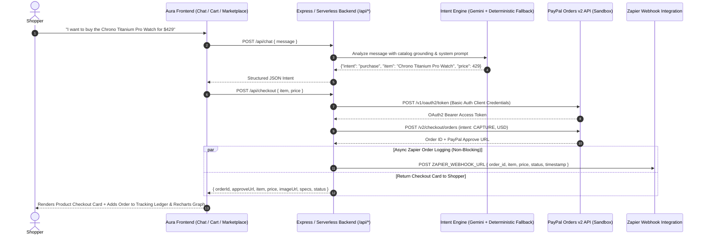

# Aura AI — Autonomous Agentic Commerce & Instant PayPal Checkout

> **Conversational Discovery · Zero-Friction Purchase Intent Extraction · PayPal Orders v2 Settlement · Automated Zapier Order Logging · Live Recharts Analytics & 5-Stage Order Tracking**

Aura AI is a full-stack **Agentic Commerce** platform that transforms traditional multi-step e-commerce into a single conversational and visual shopping experience. Instead of forcing shoppers through static forms and fragmented checkout funnels, Aura acts as an intelligent concierge across **26 curated products in 8 categories**—answering technical questions, comparing products, managing a dedicated **Shopping Cart** and **Wishlist**, autonomously detecting purchase intent, generating **PayPal Orders v2** checkout links in milliseconds, logging transactions to **Zapier**, and tracking post-purchase fulfillment in a live **Order Tracking & Recharts Analytics Ledger**.

---

## Table of Contents

1. [Executive Summary for Judges](#1-executive-summary-for-judges)
2. [Core Agentic Workflow & Architecture](#2-core-agentic-workflow--architecture)
3. [Key Features & Storefront Modules](#3-key-features--storefront-modules)
4. [Sponsor & API Integrations](#4-sponsor--api-integrations)
5. [60-Second Judge Walkthrough Guide](#5-60-second-judge-walkthrough-guide)
6. [Backend API Reference](#6-backend-api-reference)
7. [Tech Stack](#7-tech-stack)
8. [Project Structure](#8-project-structure)
9. [Local Setup & Environment Configuration](#9-local-setup--environment-configuration)
10. [Automated Unit Tests & Verification](#10-automated-unit-tests--verification)

---

## 1. Executive Summary for Judges

Traditional online stores separate **product discovery** (search bars, static filters) from **transaction execution** (cart pages, address forms, payment redirects). **Aura AI** bridges that gap using an autonomous intent pipeline:

- **Conversational Consultation**: Users ask natural questions (*"What makes the Aether ANC-1 Studio Headphones special?"* or *"Compare your marathon running sneakers"*), and Aura responds with grounded specifications, pricing, and interactive product cards.
- **Deterministic Purchase Intent Switching**: The moment a user expresses explicit buying intent (*"I want to buy the Chrono Titanium Pro Watch for $429"*), Aura halts conversational prose and emits a strict RFC 8259 JSON payload:
  ```json
  {
    "intent": "purchase",
    "item": "Chrono Titanium Pro Watch",
    "price": 429
  }
  ```
- **Instant PayPal Orders v2 Creation**: The frontend intercepts the structured purchase intent and invokes `POST /api/checkout`, which authenticates with PayPal Sandbox via OAuth2 (`POST /v1/oauth2/token`), creates a `CAPTURE` order (`POST /v2/checkout/orders`), and returns the official PayPal approval URL inside an interactive product checkout card.
- **Zapier Webhook Order Logging**: Upon generating a PayPal order link, the Express backend asynchronously dispatches the order telemetry (`order_id`, `item`, `price`, `status: "PayPal Link Generated"`, `timestamp`) to a configured **Zapier Webhook** (`ZAPIER_WEBHOOK_URL`) inside an isolated `try/catch` block so external webhook latency or errors never block customer checkout.
- **Post-Purchase Order Tracking & Recharts Analytics**: Completed orders unlock a **5-stage shipping & delivery timeline** (*Order Confirmed → Packed & Insured → Shipped · In Transit → Out for Delivery → Delivered*), instant search filtering by Order ID or Product Name, and a dual-axis **Recharts Bar Chart** visualizing spending volume (`$ USD`) and order frequency across categories and individual orders.

---

## 2. Core Agentic Workflow & Architecture



---

## 3. Key Features & Storefront Modules

### A. Autonomous AI Concierge Chat
- **Natural Hardware & Lifestyle Consultation**: Grounded in a 26-product catalog with specifications, pricing, and stock status.
- **Quick-Prompt Chips**: 1-click prompt chips allow judges to test both conversational Q&A (*"ANC-1 Specs"*, *"Lumina AR Info"*) and instant purchase intents (*"Buy ANC-1 ($349)"*, *"Buy Watch ($429)"*).
- **Inline Product Preview Cards**: When Aura recommends a specific product, an interactive card appears inside the chat bubble with **+ Cart** and **Buy ($Price)** actions.

### B. PayPal Checkout Ledger, Live Order Search & 5-Stage Order Tracking
- **Live Order Registry**: Tracks all created and captured PayPal orders in real time.
- **Instant Order Search & Filtering**: Filter active orders by **Product Name**, **Order ID** (e.g., `ORD-98741-AURA`), **Tracking Number** (e.g., `AURA-TRK-8741AURA`), or **Status** (`Completed` / `Created`) with live match counters and one-click filter reset.
- **5-Stage Shipping & Delivery Milestone Tracker**:
  1. `Order Confirmed` (20% — Aura Global Fulfillment Hub)
  2. `Packed & Insured` (40% — San Jose Dispatch Facility)
  3. `Shipped · In Transit` (65% — Memphis Express Air Hub)
  4. `Out for Delivery` (85% — Local Metropolitan Courier Depot)
  5. `Delivered` (100% — Recipient Front Door / Concierge)
- **Interactive Delivery Simulation**: Judges can click **"Simulate Sandbox Approval"** / **"Confirm & Track Order"** on any pending order to capture payment, then click **"Simulate Next Delivery Update →"** to advance the package step-by-step through the shipping milestones and receive live delivery notifications in the chat.

### C. Recharts Order Frequency & Spending Trends Visualization
- **Dual-Axis Bar Chart (`recharts`)**: Embedded directly inside the Order Tracking Ledger to visualize real-time **Spending Volume (`$ USD`)** and **Order Frequency (`Order Count`)**.
- **Interactive Grouping Modes**:
  - **By Category**: Aggregates spending and order frequency across product categories (*Audio*, *Wearables*, *Footwear*, *Bundle*, etc.).
  - **By Order**: Displays chronological order-by-order spending progression.
- **Dynamic KPI Summary Strip**: Displays live **Total Spend**, **Order Frequency**, and **Average Order Value**, updating automatically whenever new orders are created or filtered via the ledger search bar.

### D. Dedicated Online Shopping Marketplace (26 Products · 8 Categories)
- Accessible via the **Marketplace (26)** button in the navigation header.
- Features **26 curated products** with custom studio vector illustrations (`/images/*.svg`) across **8 categories**:
  1. **Electronics & Tech / Spatial Audio / Wearables / Spatial Computing / Input Hardware** (*Aether ANC-1 Studio Headphones*, *Chrono Titanium Pro Watch*, *Lumina Air AR Smart Glasses*, *Tactile 65 CNC Mechanical Keyboard*, *Cyberdeck 40 Portable Workstation*, *AeroDrone 4K Pocket Quadcopter*, *Aurora Smart Desk Lightbar*)
  2. **Fashion & Apparel** (*Aura Tailored Merino Wool Overcoat*, *Vortex Technical 3-Layer Shell Parka*, *Forma Heavyweight French Terry Hoodie*)
  3. **Footwear & Sneakers** (*AeroStride Carbon Marathon Sneakers*, *Nexus Minimal Italian Leather Low-Top*, *Zenith Vibram All-Terrain Trail Runner*)
  4. **Home & Kitchen** (*Barista Precision Compact Espresso Machine*, *Aura Heritage 5.5-Quart Enameled Dutch Oven*, *Damascus Steel 5-Piece Chef Knife Set*)
  5. **Beauty & Personal Care** (*DermaGlow Sonic Micro-Current Facial Device*, *HydroSonic Ultra-Fast High-Speed Hair Dryer*, *Celestial Botanical Recovery Serum*)
  6. **Sports & Fitness** (*PulseFlow Carbon Fiber Deep Tissue Massage Gun*, *AeroRope Digital Jump Rope with LED Matrix*, *FlexSet Quick-Adjust 50 lb Dumbbell Pair*)
  7. **Gaming** (*Apex 8K Ultra-Lightweight Wireless Gaming Mouse*, *Valkyrie Hall Effect Competitive Gamepad*)
  8. **Travel Accessories** (*Nomad Pro 30L Expandable Travel Pack*, *Aura Ultra-Light Compression Cubes 6-Pack*)
- Includes instant keyword search, category filter buttons, **Wishlist** bookmarking, **+ Add to Cart**, and **Buy via Aura / PayPal** actions.

### E. Dedicated Shopping Cart & Multi-Item Bundle Checkout Page
- Accessible via the **Cart** button in the header.
- Supports quantity increment/decrement (`+` / `−`), individual item removal, cart clearing, automatic line-item and subtotal calculation, and **1-Click PayPal Bundle Checkout** that packages all cart items into a unified PayPal order and transitions straight to the Order Tracking Ledger.

### F. Dedicated Saved Wishlist Page
- Accessible via the **Wishlist** button in the header.
- Allows shoppers to bookmark products for future purchase, view combined wishlist value, move individual items to the cart, or click **Move All Saved Items to Cart** in a single action.

---

## 4. Sponsor & API Integrations

### 1. PayPal Developer Sandbox (Orders v2 API)
- **OAuth2 Token Generation**: `getPayPalAccessToken()` in `server.js` encodes `PAYPAL_CLIENT_ID:PAYPAL_CLIENT_SECRET` in Base64 and exchanges it at `https://api-m.sandbox.paypal.com/v1/oauth2/token` (`grant_type=client_credentials`).
- **Order Creation**: `POST /api/checkout` submits a `CAPTURE` intent order in `USD` to `https://api-m.sandbox.paypal.com/v2/checkout/orders` and extracts the `approve` (`payer-action`) hateoas link.
- **Resilient Preview Fallback**: If Sandbox credentials are omitted in a judge's local environment, the server gracefully generates a realistic Sandbox preview token (`EC-AURA-...`) so the full UI, ledger, and tracking flow remain 100% testable.

### 2. Zapier Webhook Automation (`ZAPIER_WEBHOOK_URL`)
- **Automated Order Logging**: Every time `/api/checkout` generates a PayPal link, the server sends an asynchronous `axios.post` request to `process.env.ZAPIER_WEBHOOK_URL` with the payload:
  ```json
  {
    "order_id": "2N465768P6857072V",
    "item": "Chrono Titanium Pro Watch",
    "price": 429,
    "status": "PayPal Link Generated",
    "timestamp": "2026-11-11T13:22:55.447Z"
  }
  ```
- **Fault-Isolated Execution**: Wrapped in its own `try/catch` block with an 8-second timeout so that any webhook failure or misconfiguration is logged safely without crashing the server or delaying the PayPal link response to the user.

### 3. Google GenAI SDK (`@google/genai`) + Resilient Intent Engine
- Uses `@google/genai` on the backend (`POST /api/chat`) with strict system instructions and full catalog context.
- Paired with a deterministic fallback intent parser (`generateFallbackAuraResponse` & `parsePurchaseIntent`) and Vercel Serverless Function wrappers (`/api/*` + `vercel.json`) so chat and checkout work reliably across local Node servers, serverless deployments, and static previews.

---

## 5. 60-Second Judge Walkthrough Guide

1. **Launch the Workspace**:
   - On the landing page, click **"Sign Up to Start Shopping"** (or **"Marketplace (26)"** / **"Cart"** in the top navigation bar) to enter the interactive workspace.
2. **Test Conversational AI & Instant PayPal Purchase Intent**:
   - In the Aura chat box, click the quick prompt **"Buy Watch ($429)"** or type:
     ```text
     I want to buy the Chrono Titanium Pro Watch for $429
     ```
   - Observe Aura emit the structured JSON intent, create a PayPal Sandbox order, render the visual checkout card in the chat stream, and add the order to the **PayPal Checkout & Order Tracking Ledger**.
3. **Inspect the Recharts Bar Chart & Filter the Order Ledger**:
   - In the right-hand **PayPal Checkout & Order Tracking** panel, inspect the **Order Frequency & Spending Trends** bar chart.
   - Toggle between **By Category** and **By Order** to see the bars and KPI metrics (`Total Spend`, `Frequency`, `Avg Order`) update.
   - Type `Watch` or `ORD-98741` in the **Search orders by product name or order ID...** input and watch both the order list and the bar chart filter in real time.
4. **Simulate Order Capture & Live 5-Stage Shipping Updates**:
   - On any pending order, click **"Simulate Sandbox Approval"** (or **"Confirm & Track Order"**).
   - Once captured, click **"Simulate Next Delivery Update →"** inside the order's tracking card to advance the shipment from *Packed & Insured* → *Shipped · In Transit* → *Out for Delivery* → *Delivered*.
5. **Explore the Dedicated Marketplace, Wishlist & Shopping Cart Pages**:
   - Click **Marketplace (26)** in the top header to browse all 26 products across 8 categories, save items to your **Wishlist**, add multiple items to your **Cart**, and run a multi-item **Bundle Checkout**.

---

## 6. Backend API Reference

| Method | Endpoint | Description |
| :--- | :--- | :--- |
| `POST` | `/api/chat` | Accepts `{ "message": "..." }`. Calls Gemini with catalog grounding (or fallback intent engine) and returns conversational text or raw purchase intent JSON `{"intent":"purchase","item":"...","price":...}`. |
| `POST` | `/api/checkout` | Accepts `{ "item": "...", "price": 429 }`. Authenticates with PayPal Sandbox OAuth2, creates a PayPal v2 `CAPTURE` order, logs the order to `ZAPIER_WEBHOOK_URL`, and returns `{ approveUrl, orderId, item, price, imageUrl, category, specs, status }`. |
| `GET` | `/api/catalog` | Returns the full 26-product curated catalog (`{ gadgets: [...] }`). |
| `GET` | `/api/orders` | Returns the active session orders list (`{ orders: [...] }`). |
| `POST` | `/api/orders/capture` | Accepts `{ "orderId": "..." }`. Transitions an order to `COMPLETED` and initializes 5-stage shipping & delivery tracking. |
| `POST` | `/api/orders/track-advance` | Accepts `{ "orderId": "..." }`. Advances a completed order's shipping status to the next milestone along the 5-stage delivery timeline. |

---

## 7. Tech Stack

- **Frontend**: React 19, TypeScript, Tailwind CSS, Recharts (`BarChart`, `ResponsiveContainer`, `Tooltip`, `Legend`), Framer Motion (`motion`), Lucide Icons, Vite.
- **Backend**: Node.js, Express.js (`server.js`), Axios, Dotenv, CORS, Vercel Serverless Function adapters (`/api/*`).
- **AI & Commerce Integrations**:
  - Google GenAI SDK (`@google/genai`)
  - PayPal Checkout Orders v2 REST API (`api-m.sandbox.paypal.com`)
  - Zapier Incoming Webhooks (`ZAPIER_WEBHOOK_URL`)
- **Testing**: Node.js built-in test runner (`node:test` + `node:assert/strict`) executed via `tsx`.

---

## 8. Project Structure

```text
├── api/                          # Vercel Serverless Function entry points
│   ├── index.js                  # Catch-all API router forwarding to Express app
│   ├── chat.js                   # Serverless route for POST /api/chat
│   ├── checkout.js               # Serverless route for POST /api/checkout
│   └── orders.js                 # Serverless route for /api/orders/*
├── public/                       # Static assets & standalone storefront view
│   ├── images/                   # 26 custom studio SVG product illustrations
│   └── index.html                # Full interactive storefront & chat workspace
├── src/                          # React + TypeScript application source
│   ├── components/
│   │   ├── AuthModal.tsx         # Sign-in / Sign-up authentication modal
│   │   ├── ChatPage.tsx          # Main AI Chat, Order Ledger, Cart, Wishlist & Marketplace views
│   │   ├── HeroSection.tsx       # Landing page hero, architecture overview & 3-step guide
│   │   ├── Navbar.tsx            # Top navigation bar with live Marketplace/Wishlist/Cart badges
│   │   └── OrderTrendsChart.tsx  # Recharts BarChart for Order Frequency & Spending Trends
│   ├── utils/
│   │   ├── auth.ts               # Pure authentication & validation helpers
│   │   ├── auth.test.ts          # Unit tests for authentication validation
│   │   ├── commerce.ts           # Pure business logic (intent parser, PayPal, Zapier, Cart, Wishlist, Tracking, Recharts trends)
│   │   └── commerce.test.ts      # 22 unit tests covering all commerce & analytics logic
│   ├── App.tsx                   # Root React component & view state router
│   └── main.tsx                  # React DOM entry point
├── .env.example                  # Template for environment variables
├── metadata.json                 # Application metadata & capabilities manifest
├── package.json                  # Scripts and dependencies
├── server.js                     # Express backend server (Gemini, PayPal v2, Zapier, Order Tracking)
├── vercel.json                   # Vercel rewrite configuration for /api/* routes
└── vite.config.ts                # Vite bundler configuration
```

---

## 9. Local Setup & Environment Configuration

### Prerequisites
- **Node.js** v18+ (v20 or v22 recommended)
- **npm** or **bun**

### 1. Install Dependencies
```bash
npm install
```

### 2. Configure Environment Variables
Copy `.env.example` to `.env` and populate your keys:
```bash
cp .env.example .env
```

```env
# Google Gemini API Key for Aura conversational AI and purchase intent detection
GEMINI_API_KEY="YOUR_GEMINI_API_KEY"

# PayPal Developer Sandbox Credentials for Orders v2 OAuth2 token generation
PAYPAL_CLIENT_ID="YOUR_PAYPAL_SANDBOX_CLIENT_ID"
PAYPAL_CLIENT_SECRET="YOUR_PAYPAL_SANDBOX_CLIENT_SECRET"

# Zapier Incoming Webhook URL for automated order logging
ZAPIER_WEBHOOK_URL="https://hooks.zapier.com/hooks/catch/your_webhook_id"

# Public URL where the application is hosted
APP_URL="http://localhost:3000"
```
*(Note: If any external credential is omitted during local evaluation, Aura automatically activates its built-in sandbox preview fallbacks so every feature works out of the box.)*

### 3. Start the Application Server
```bash
npm start
# or
npm run dev
```
The server will start on **`http://localhost:3000`**.

---

## 10. Automated Unit Tests & Verification

All core business logic is decoupled into pure TypeScript functions in `src/utils/commerce.ts` and `src/utils/auth.ts` and verified with **22 automated unit tests**:

```bash
npx tsx --test src/utils/commerce.test.ts src/utils/auth.test.ts
```

**What the test suite verifies:**
- Raw and markdown-fenced JSON purchase intent extraction (`parsePurchaseIntent`).
- Checkout input validation and PayPal Orders v2 `CAPTURE` payload construction (`buildPayPalOrderPayload`, `extractApprovalUrl`).
- Zapier webhook payload formatting (`buildZapierOrderPayload`).
- Shopping Cart item addition, quantity updates, removals, and bundle subtotal math (`addToCart`, `calculateCartSummary`).
- Saved Wishlist toggling and bulk Cart transfers (`toggleWishlistItem`, `moveAllWishlistToCart`).
- 26-product catalog filtering by category and search query (`filterCatalogProducts`).
- 5-stage Order Tracking initialization and milestone advancement (`createOrderTrackingInfo`, `advanceOrderTrackingStep`).
- Order Ledger filtering by Order ID, Product Name, Tracking Number, and Status (`filterOrders`).
- Recharts order frequency and spending trend aggregation across categories and timelines (`calculateOrderTrends`).
